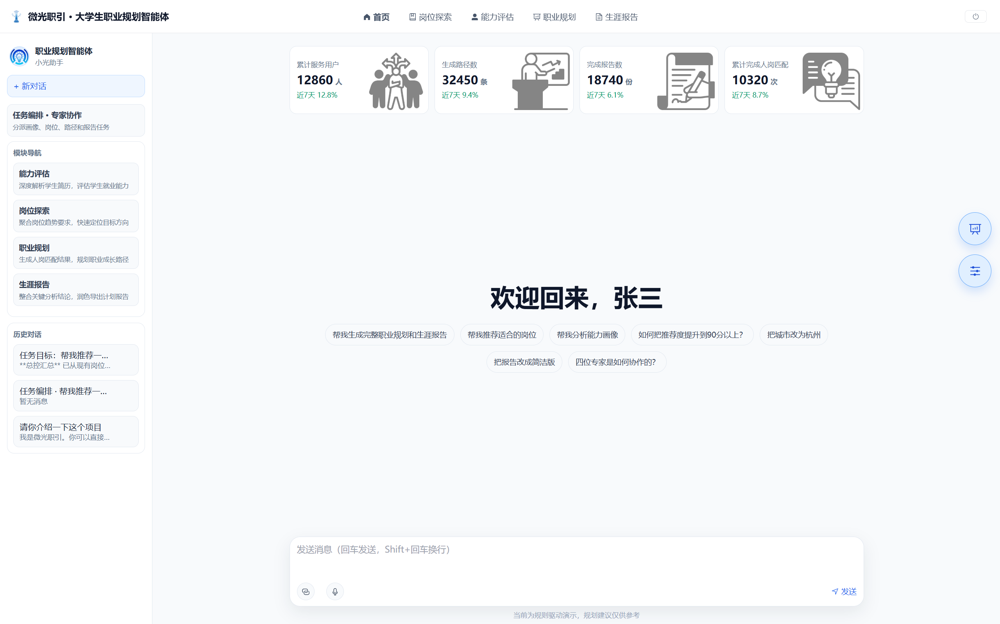
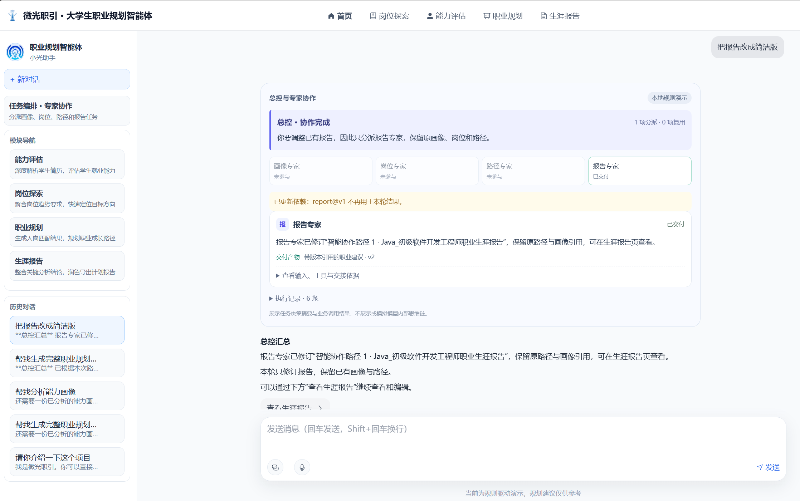
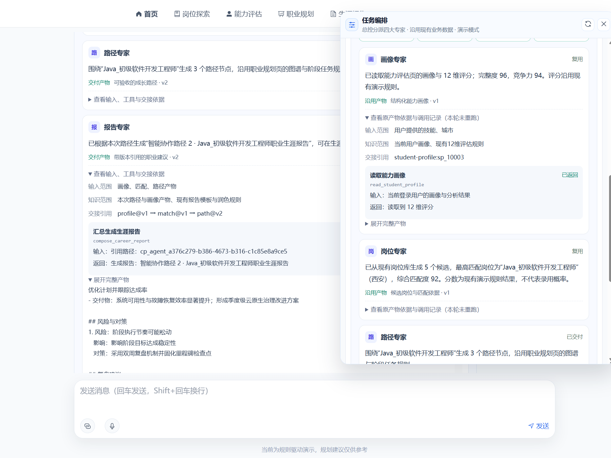
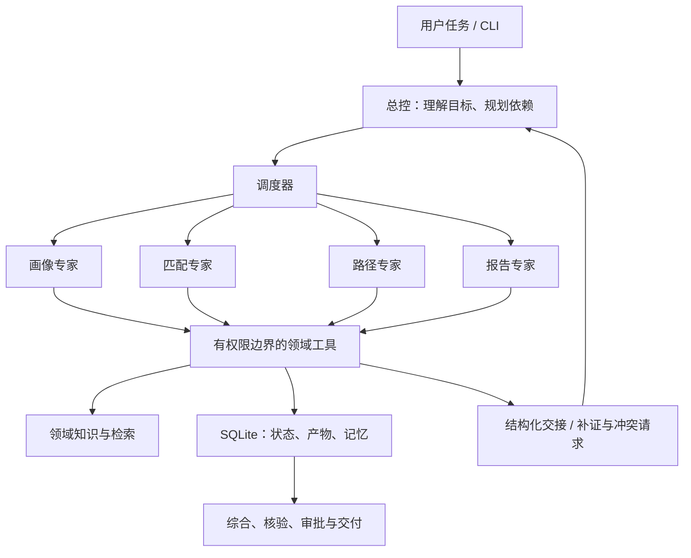

# 背景说明

本项目为“微光职引”大学生职业规划智能体的Agent核心。不含前端与后端其它部分的源代码。

【A13】基于AI的大学生职业规划智能体：在数字经济与产业升级双轮驱动的时代背景下，大学生就业问题已从单一的人才输送命题，演变为检验教育适配性、技术前瞻性和社会协同性的复杂系统工程。当前，我国正处于“十四五”规划收官与“十五五”规划启航的交汇点，就业市场呈现出“冰火两重天”的显著特征：一方面，智能制造、量子信息等战略新兴产业面临大量的人才缺口，企业求贤若渴；另一方面，传统专业毕业生待业率长期徘徊在23%以上，结构性失业问题凸显。这种“岗位荒”与“就业难”并存的悖论，暴露了就业能力和社会经济发展需求的供需不匹配。

当前大学生做好职业规划难，是就业市场、自身认知、支持体系与外部环境多重因素交织的结果。一方面，毕业生规模持续攀升，行业供需失衡，用人单位抬高招聘门槛，就业竞争压力空前；学生自身则普遍存在自我认知模糊、职业认知片面的问题，专业选择缺乏自主性，对行业的了解多为碎片化信息，易受同龄人压力影响盲目跟风考研、考证。另一方面，高校生涯教育重简历撰写、面试技巧等表层技能，缺乏系统的自我认知引导，专业指导师资匮乏；家庭支持又存在干预过度或引导缺位的两极问题。同时，科技迭代与产业转型加速重塑职业格局，新兴职业涌现、传统职业受冲击，职业路径难以预测，再加上社会对职业价值的刻板评价与过高的教育回报预期，进一步加剧了大学生职业规划的决策难度。

项目获第十七届中国大学生服务外包创新创业大赛【国家级二等奖】。

## 微光职引 · 职业规划智能体

通过企业提供的岗位数据10000条，共约100个岗位。数据字段包括：职位名称、工作地址、薪资范围、公司全称、所属行业、人员规模、企业性质、职位编码、职位描述、公司简介等，开发面向大学生的职业规划智能体。总控根据用户目标，组织**画像、匹配、路径、报告**四个专家完成分析：从简历和行为证据建立能力画像，结合岗位条件查找方向，规划成长路径，并生成有来源、能追问、可更新的职业建议。

系统以 TypeScript 和 LangGraph 实现，提供 CLI、领域工具、混合检索、持久化执行与版本化记忆，当前提供本地 CLI 接口；外部应用可依据输入、事件和产物契约进行适配。

## 预览

[在线演示(未接入大模型)](https://career-planner.tonks.top/)

**从首页直接提出目标。** 上传简历或选择快捷问题，即可开始画像、岗位、路径和报告的协作流程。



**总控解释分派，专家交付结果。** 对话显示参与角色、完成状态、专家应答及产物版本；局部修改只调用相关专家。



<details>
<summary>展开查看：工具返回与交接依据</summary>

岗位专家展示输入范围、知识范围、上游画像引用及实际业务调用的返回摘要，完整产物按需展开。这里展示可核查的执行记录，不模拟模型内部思维链。



</details>

## 功能

| 能力 | 说明 |
| --- | --- |
| 能力画像 | 基于简历与具体行为建立12维描述性画像，区分“信息未知”和“明确缺失”，给出需要补充的材料 |
| 岗位匹配 | 按城市、学历、经验、薪资、工作制等条件筛选岗位，解释匹配理由、技能差距与待核实条件 |
| 成长路径 | 基于岗位类别图生成晋升或迁移路线，核验实际图边和目标岗位，形成阶段行动建议 |
| 职业报告 | 综合已授权的专业产物，整理事实、依据、限制与下一步，支持草稿和局部修订 |
| 多轮追问 | 补充材料、修改城市或目标后继续对话，保留未解决问题，重新检查受影响的结论 |
| 长期记忆 | 按用户和领域保存带来源的事实，支持审批写入、纠正、撤回、到期和整体遗忘 |
| 执行恢复 | 持久化计划、工具结果和状态，在允许的故障边界内恢复任务，保留失败原因 |

画像分数是描述性估计，不是心理测量或录用概率。岗位条件缺失时保留待核实状态，不自动视为符合；无依据的个人事实不会由领域规则代填。

## 系统架构



### 总控与专家

总控提交带依赖的任务计划，运行时检查步骤身份、权限和环，再调度具备输入的步骤。画像任务可以只使用画像专家；完整规划通常依次使用画像、匹配、路径和报告。只有依赖允许的步骤才能并行。

| 专家 | 职责 | 主要工具与知识 |
| --- | --- | --- |
| `profile` | 识别用户事实、行为证据、冲突与未知项，提交画像和追问 | 简历与历史读取、锚点评分、画像规则、授权画像记忆 |
| `match` | 类别召回、岗位硬条件检查、匹配解释、技能缺口 | 类别/岗位检索、岗位检查、匹配规则、授权画像产物 |
| `path` | 路线搜索、边与目标校验、阶段行动 | 有界无环路径搜索、类别/岗位工具、路径规则、上游产物 |
| `report` | 整理引用、检查一致性、明确限制、生成与修改报告 | 授权产物和来源读取、报告检查、草稿与精确编辑 |

每个专家有独立的消息历史、工作状态、工具白名单和知识视图。它们可以共用模型服务与同一个 Node 进程；隔离由运行时的上下文和访问检查实现。专业指令位于 [prompts/](prompts/)，领域规则位于 [knowledge/](knowledge/)。

### 通信、上下文与记忆

- **结构化交接**：通过专业产物传递摘要、结果、证据引用、未知项和后续动作；完整私有历史不会自动广播。接收者按权限分页读取必要详情。
- **协调与失效传播**：专家可向总控提交补证、冲突或协助请求。总控修订计划，运行时撤销受影响的下游产物与待审批记忆，无关步骤可以保留。
- **上下文管理**：保留完整工具调用/结果对、有限证据摘要和检索工作状态；原始输入与详情可按身份和引用重新读取。摘要不产生新的证据权限。
- **三层记忆**：工作消息用于当前推理；SQLite checkpoint 与产物保存执行状态；长期记忆按用户及 `shared/profile/match/path/report` 命名空间保存带版本、来源和有效期的事实。
- **用户控制**：模型提出长期记忆变更，批准后提交；用户可纠正、撤回或遗忘。新的事实与约束使不再有效的工作结果失效。

详见[系统设计](docs/architecture/system-design.md)、[动态协作](docs/architecture/dynamic-coordination.md)与[上下文管理](docs/architecture/context-management.md)。

### 知识与检索

知识子集是共享数据上的授权视图，可以存在合理重叠。检索先限制领域权限，岗位筛选由代码核对硬条件；文本召回支持 BM25，并可加入本地 BGE 向量检索，以 RRF 合并排序。原文按 tokenizer 切块，保留来源、版本与偏移，支持分页读取。

岗位空结果、过滤统计和图路径计算也可形成带查询与快照身份的来源，供专家交接和最终核验使用。详情见[检索实现](docs/architecture/retrieval.md)与[计算证据](docs/architecture/calculation-evidence.md)。

### 技术栈

| 层 | 技术与职责 |
| --- | --- |
| 类型与契约 | TypeScript、Zod：输入、计划、工具参数和产物校验 |
| 编排 | LangGraph：总控状态图、专家工具循环、审批中断与 checkpoint |
| 存储 | Node.js 内置 SQLite / WAL：运行、事件、产物、记忆、缓存和租约 |
| 模型接入 | OpenAI 兼容流式 HTTP，当前配置支持 DeepSeek |
| 检索 | BM25、Transformers/ONNX 本地向量、余弦相似度与 RRF |
| 使用接口 | CLI JSON 输入输出、执行事件；HTTP/SSE 适配单独建设 |

## 快速开始

需要 Node.js 24 或更高版本。在仓库目录执行：

```powershell
npm ci
Copy-Item .env.example .env
# 在本地 .env 填写 CAREER_API_KEY、CAREER_BASE_URL、CAREER_MODEL
npm run build
npm run cli -- run --case evals/examples/profile.json --architecture multi-agent --live --events
```

默认使用 BM25；显式传入 `--live` 才会调用模型服务。`.env`、本地索引、模型缓存和运行库不进入 Git。完整规划、多轮续接、审批、容量配置和混合检索用法见[运行指南](docs/architecture/runtime-usage.md)。

```powershell
npm run cli -- inspect --run RUN_ID --user USER_ID
npm run cli -- reply --run PARENT_RUN_ID --user USER_ID --case evals/examples/reply.json --live
npm run cli -- resume --run RUN_ID --user USER_ID --live
npm run cli -- approve --run RUN_ID --user USER_ID --approval APPROVAL_ID --live
npm run cli -- memory --user USER_ID
```

`reply` 创建承接新输入的任务；`resume` 恢复原任务。更换数据库、数据集或索引后，恢复操作必须使用与原任务一致的配置。

## 仓库地图

```text
src/                  智能体运行时、工具、检索、记忆、持久化与接口
prompts/              总控与四个专家的专业指令
knowledge/            领域规则与可引用知识
data/synthetic/       可公开的示例岗位、类别与路径图
scripts/              数据处理、开发和维护入口
tests/                契约、集成、恢复及工具测试
docs/architecture/    系统设计、运行指南与接入方案
docs/assets/          README 界面截图与公开图示
docs/development/     实现边界与开发规范
docs/evaluation/      架构选择、最终结论与统计
evals/                示例任务、场景和评估配置
skills/               同源专业指令的对照实现
var/                  本地运行与完整记录（Git忽略）
```

逐文件职责、文档位置和阅读顺序见[完整项目地图](docs/README.md)。

## 开发与接入

```powershell
npm run check
npm run format:check
npm run public:check
```

当前提供 CLI 与智能体核心，仍在完善交付核验。生产鉴权、Web API、文件解析、OCR 和视觉输入尚未包含；具体边界见[实现状态](docs/development/implementation-status.md)。核验未完成时保留草稿并明确返回状态，不把草稿冒充已交付建议。

Web 展示可以在独立前后端中实现。本仓库聚焦智能体核心，不包含 Web 页面、云端任务队列或部署配置。

架构对照的最终结论与汇总统计集中在 [docs/evaluation/](docs/evaluation/README.md)；关于多智能体设计取舍、真实对话观察和面试表达，见[架构选择说明](docs/evaluation/multi-agent-rationale.md)。
