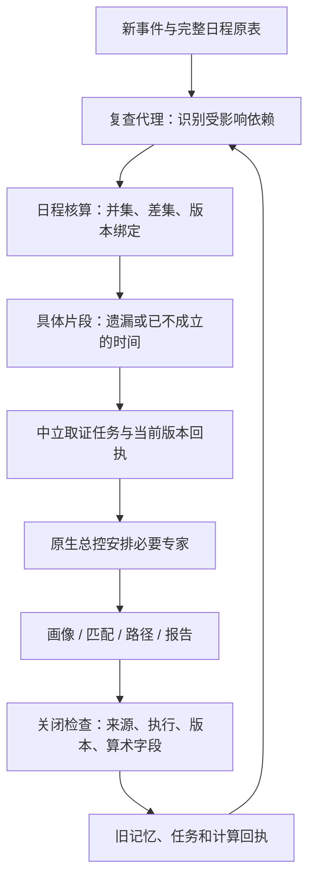

# V16：带计算回执的长期记忆探针

这是“基于反例取证与持续复核的长期记忆探针”的一轮实现与实验。目标是把自然语言反例落到可检查的具体证据片段，并检验显式反例策略是否优于同样拥有计算工具的普通复查与自然语言探针。

**结果：三组最终岗位核定与候选集合均为6/6正确，显式反例策略没有显示独立准确率收益。** 反例片段、来源版本回执、跨轮任务和局部复核已实际运行；同时发现当前/历史值混写及业务反例量词理解错误。详见 [RESULTS.md](RESULTS.md)。

## 机制



三组都拥有完整的核算与差集工具。自然语言探针和显式反例探针共用状态机、初始登记、回执与关闭检查，仅复查策略提示不同。所有分支从同一份真实多智能体初始历史复制，保留相同父运行、原件和产物；历史产物查阅不继承原来源权限。

本轮的回执证明原表内的时段运算，岗位资格仍由专家根据岗位原件核定。具体时间片段是否足以推翻资格结论，是下一步需要独立验证的环节。

## 代表性改进

- 前期接口修正：修正引用校验、任务执行与关闭状态、重复派发。
- 同源历史验证：同源历史分叉和局部复核；看到候选行动一致性的局部收益，并发现两组共同漏算一小时。
- **V16：** 共同引入计算回执和中立问题渲染，再对显式反例提示做三组比较；进一步定位到“来源真实不代表推导正确”“差异存在不代表业务结论改变”。

## 文件

- [PROTOCOL.md](PROTOCOL.md)：正式运行前冻结的实验设计与预运行修正说明。
- `calendar-check.mjs`：来源绑定的时段核算、反例片段、算术关闭检查。
- `probe.mjs` / `state.mjs`：三组复查策略和持久任务状态。
- `run.mjs` / `snapshot.mjs`：相同历史分叉、原生多智能体执行、预算及恢复。
- `data/test.json` / `private/gold.json`：合成输入与仅离线评分可读的答案。
- `analyze.mjs` / `scoring.mjs`：冻结评分；不在看过结果后修改规则。
- `audit.mjs` / `independent-audit.py`：来源、回执、权限、分叉、评分及用量核验。
- `extract-content-review.py`：生成原文阅读片段，支持另列的事后内容复核。
- [results/test-r2](results/test-r2)：正式统计、验证、用量和精简逐事件记录。

完整请求/响应、数据库及token流在本地忽略目录 `var/advice-repair-v16/`；精简导出去掉重复流和模型输入，保存原始/导出文件SHA256。预运行保留为 `test-r1`，正式对照为 `test-r2`，两者分叉结果不混合。

## 复现

仓库根目录执行。运行器从仓库上一级 `api.txt` 读取服务密钥，密钥不进入实验记录。

```sh
npm run build
node --test evals/advice-repair-v16/*.test.mjs
node evals/advice-repair-v16/run.mjs register var/advice-repair-v16/new-run test 4
node evals/advice-repair-v16/run.mjs live var/advice-repair-v16/new-run test 4
node evals/advice-repair-v16/analyze.mjs var/advice-repair-v16/new-run
node evals/advice-repair-v16/summarize-usage.mjs var/advice-repair-v16/new-run
node evals/advice-repair-v16/audit.mjs var/advice-repair-v16/new-run
python3 evals/advice-repair-v16/independent-audit.py var/advice-repair-v16/new-run
```

注册命令可追加同数据的既有实验根目录作为共同前缀来源；它会复制全部事先指定的共同前缀并保存来源哈希，不选择性复制表现较好的历史。新运行会产生新的服务调用。

## 公开记录核验

在仓库根目录运行 `python3 research/memory-evidence-probe/scripts/verify-native-rounds.py`，无需模型密钥，重算最终核定、候选集合并核验公开记录哈希。`results/test-r2` 为脱敏精简导出，保留原生事件、产物、业务回执及响应；SQLite、流式片段与重复模型输入保留本地。原先依赖完整本地运行的审计脚本按原样保留，不对精简目录执行。
