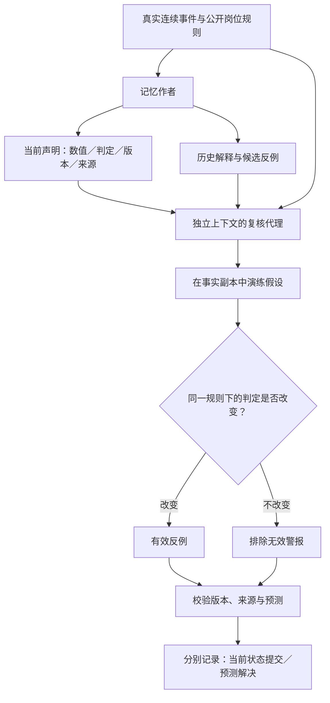

# V17：让记忆探针区分“事实变了”和“结论被推翻了”

本轮延续“反例取证与持续复核”的长期记忆探针，修复 V16 暴露的两个接口问题：历史说明干扰当前状态提交；模型把日程变化直接当成岗位判定变化。

## 实现

1. **当前声明与历史叙述分离。** `currentAssessment` 保存事实版本、当前周工时、岗位判定、规则版本及来源 ID；摘要继续解释历史变化。原型的专家产物、上下文传递、存储和来源权限校验支持这个可选字段。
2. **反例必须通过业务谓词验证。** 同一事实副本演练变化前后的公开规则。只有判定真的变化，才承认它是反例。“周五少一小时”本身不是反例；如果周一和周三仍满足“至少两天各四小时”，该变化不会推翻资格。
3. **提交当前状态与解决反例分开。** 当前结论可以提交，而尚未通过验证的预测继续待解决。规则、事实版本或引用不匹配时，不把它当成新证据。验证器不自动把错误预测改成正确输出。



## 对照如何公平

4 个合成场景，每场景 4 个连续事件；每事件同一作者输出交给三个独立复核上下文：

| 组别 | 当前状态关闭依据 | 预测接纳依据 |
|---|---|---|
| text | 旧摘要数值读取器 | 模型报告＋版本绑定 |
| structured | 结构化当前值 | 模型报告＋版本绑定 |
| verified | 结构化当前值＋当前业务判定 | 额外验证假设是否改变业务判定 |

三组拥有相同来源、工具、复核指令和最大调用次数。共享作者只生成一次。每事件两个假设分别检验两个岗位，合计 64 个假设判定。规则卡直接提供结构化时间条件；私有答案由独立 Python 分钟集合算法生成，不进入模型上下文或工具。

这是作者与复核者的**双代理组件实验**。字段进入原生原型的数据通路并有集成测试；本轮业务校验与关闭门控由实验驱动器运行，没有重跑原生四专家流程。完整冻结方案见 [PROTOCOL.md](PROTOCOL.md)，结果见 [RESULTS.md](RESULTS.md)。

## 复现与记录

无需密钥的公开记录核验：`python3 research/memory-evidence-probe/scripts/verify-native-rounds.py`。历史冻结代码和结果保持不变；本次发布后的格式化源码不用于替换历史哈希。

在仓库根目录运行（需要支持 `Array.prototype.toSorted` 的 Node，以及 Python 3）：

```sh
npm ci
npm run build
python3 evals/advice-repair-v17/gold.py
node --test evals/advice-repair-v17/*.test.mjs
node evals/advice-repair-v17/run.mjs register var/advice-repair-v17/your-run
node evals/advice-repair-v17/run.mjs live var/advice-repair-v17/your-run
node evals/advice-repair-v17/analyze.mjs var/advice-repair-v17/your-run
```

正式实验读取仓库上一级 `api.txt` 中的 DeepSeek 密钥；文件不得提交。模型为 `deepseek-flash`。`register` 冻结当时的源文件、数据、脚本、协议。已保存的完成响应会原样回放恢复，不重复发送。新运行应使用新输出目录。历史运行可以在其 `source-snapshot` 中还原冻结文件后复现；分析脚本另在结果目录保存。

`results/test-r1` 保留共享作者输出、各组复核输出、完整请求与响应、工具回执、逐事件得分、用量与冻结文件。`shared-author-replay.json` 是对同一作者原始预测应用三种门控的离线配对回放，不计作新增模型实验。回归测试中的人工故障样例单独报告，不混入实时正确率。
