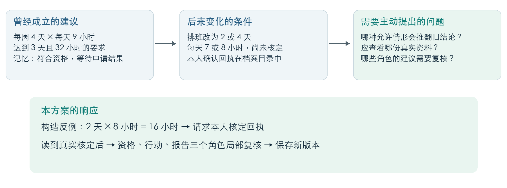
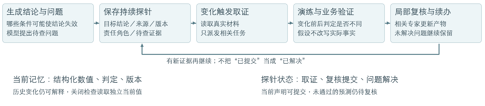
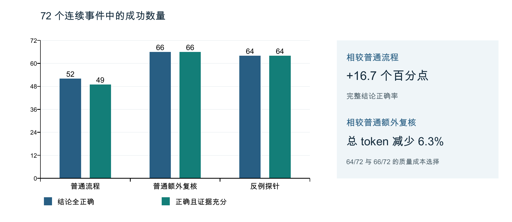

# 基于反例取证与持续复核的长期记忆探针

**让大模型把自己的结论转化为可检验、可持续处理的问题**

本项目探索大模型把自己的建议转化为可检验问题的能力：提出建议时，同时指出它依赖什么条件、什么新证据会使建议改变，并在后续交流中继续追踪。我们将复查问题、目标建议、证据需求和责任角色组织成可执行、可跨事件续办的“记忆探针”。

原型由同一模型依次承担资格、行动、报告三个角色。早期连续事件实验中，探针组完整正确数由普通流程的52/72提升至64/72；相较额外复核，总token减少6.3%，正确数为64/72与66/72。第四轮四组实验进一步拆分条件演练和持续任务，完成4608次事件处理：两项机制平均效应分别为+0.69和+0.09个百分点，95%区间均包含零。后续接入原生四专家流程，并针对当前值混入历史说明、条件变化被误当成有效反例两个问题开展组件实验：16个正确状态均能结构化提交；原始预测回放拦截3个错误、保留61个正确预测。充分取证后的三组预测均为64/64正确。



## 从现象到问题

例如，旧记忆认为用户符合某岗位资格，申请仍在处理中。后来排班变为多种候选，系统需要重新判断资格、行动和报告结论。难点不仅是发现新旧文字不同，还包括：哪些旧结论可能失效、哪种条件能推翻它、应读取什么资料，以及取证结果应该交给哪个角色。

我们的核心问题是：**能否让模型把“这条记忆可能错了”转成一个可以执行、可以追踪结果的证据请求？**

## 原创机制

原创切入点是把“何时需要重新考虑建议”本身纳入长期记忆，并转成持续取证任务。探针是附着于建议的定向复查任务：它提出可核验的问题，通过后续证据取得反馈。

1. **生成问题**：模型指出建议依赖的条件和待查证据；实验比较直接取证与先显式演练两个不同结论分支再取证。
2. **保存任务**：绑定目标建议、事实与规则版本、责任角色和来源引用；持续组将未解决问题保存到后续事件。
3. **获取证据**：新信息到达后检查问题是否仍适用，选择资料目录中的真实材料。假设保留在任务通道，真实事实由观测和实际读取更新。
4. **复核与续办**：角色依据真实证据更新建议，分别记录资料读取、角色提交及问题状态；资料缺失时保留待办，版本改变时重新检查。



最新设计将当前声明与历史解释分开，并对支持的时间规则验证“变化是否真的改变判定”。任务调度已经在原生四专家中运行，新增业务验证完成双代理组件实验。

同一条件可能影响资格、行动和报告多个结论。探针把问题关联到责任角色，协调各角色依据更新后的事实重新判断。第三轮采用局部角色复核；第四轮固定执行三个角色，单独检验取证方式与任务保存的作用。

第四轮在每个事件后序列化恢复状态，第五个事件后将原始历史共同截到最近两条。持续组额外装载待查任务；各组仍保留相同基础事实、来源和读取回执。任务状态与历史摘要分开保存，使问题能够跨事件继续处理。

## 与现有产品的差异化

下表比较各产品公开文档描述的主要机制与本项目的设计重心。

| 产品／框架 | 官方公开能力 | 本方案的设计侧重点 |
|---|---|---|
| [Hindsight](https://hindsight.vectorize.io/blog/2026/06/17/freshness-aware-memory) | 标记整合记忆相对新事实的滞后状态，引导模型回查原始事实核验 | 围绕具体建议提出“哪些条件变化需要重新考虑”，将问题与证据需求保存为可继续执行的探针任务 |
| [Letta](https://docs.letta.com/agent-sdk/memory) | 持久记忆、Git版本管理、共享记忆，以及后台代理整理对话并更新记忆 | 为待查问题绑定目标结论、责任角色和版本，分开记录当前声明提交与问题解决 |
| [Graphiti（Zep的开源框架）](https://help.getzep.com/graphiti/getting-started/overview) | 追踪事实及关系变化，支持事实失效处理、历史查询和来源追溯 | 关联结论的待查问题，校验候选变化是否真的改变判定，再依据真实证据更新 |

本方案可作为现有记忆能力之上的复核机制。预期价值是减少旧建议遗漏更新、保留未完成问题，并解释建议为何改变；这些设计侧重点与下文的实测结果分别呈现。

研究上，[StateGraph](https://arxiv.org/abs/2611.02912) 讨论依赖感知的记忆修订与反事实验证，[COUNTERMEM](https://arxiv.org/abs/2609.31874) 讨论经验证的反事实记忆，[CRITIC](https://arxiv.org/abs/2305.11738) 讨论工具反馈纠错。本项目将相关能力组织成反例驱动的取证任务，并在连续、多角色状态上检验其效果。

## 代表性实验

前四轮依次检验状态动作协议、提交一致性、主动取证闭环，以及核心机制的独立贡献；后续代表性实验补充原生多智能体接入与业务反例验证。各轮使用自己的数据与评分标准，表内比较均为同期对照。

### 第一轮 双模型同题比较与状态动作接口改进

发现的问题是：资格、行动和外部回执状态的定义混在一起，模型正文与结构字段可能表达不同处置。改进方式是明确状态及动作接口，并比较静态卡、自由探针和条件式探针。

每模型每组54个测试格，来自3个岗位、9个分支和2档上下文。GPT配置为 `gpt-6.1-sol / medium / 8192`，DeepSeek为 `deepseek-flash / thinking disabled / 1100`；两者使用相同题目、上下文预算及回读权限。严格通过同时检查标签、处置和正文证据。

| 组别 | DeepSeek 主评审 | GPT 主评审 | DeepSeek GPT复核 | GPT GPT复核 |
|---|---:|---:|---:|---:|
| 原协议＋自由探针 O | 2/54 | 13/54 | 2/54 | 13/54 |
| 明确接口＋静态卡 B | 29/54 | 42/54 | 18/54 | 33/54 |
| 明确接口＋自由探针 L | 29/54 | 43/54 | 12/54 | 39/54 |
| 明确接口＋条件探针 N | 31/54 | 43/54 | 16/54 | 40/54 |

“主评审”列按生成模型区分，评分模型均为DeepSeek；后两列使用GPT评分。保持自由探针不变时，接口改进使两模型主评审通过数分别从2提升至29、从13提升至43。由此确定后续工程基础：先把目标状态和动作说清楚，再让探针承担主动取证。后续重点转向真实回执读取、提交一致性以及连续事件中的局部复核。

数据与完整评分：[01-cross-model](experiments/01-cross-model/)。

### 第二轮 改善结论到记忆提交的一致性

发现的问题是：模型说明已经得出正确结论，但提交字段仍保留旧值。改进方式是只调整JSON示例键序，让简短结论说明先于提交字段生成，并保留额外一次复核作为对照。

| 方案 | 新72例正确数 | 已见24例回归 | 全96例独立策略总token |
|---|---:|---:|---:|
| 原提交顺序 | 66/72 | 20/24 | 290,435 |
| 说明先行 | 70/72 | 24/24 | 289,863 |
| 额外提交复核 | 71/72 | 23/24 | 573,481 |

说明先行修复了5个新例中的正文与字段冲突，新例正确率由91.7%提升至97.2%，token基本持平。此后将清晰、稳定的提交接口作为三组共同基础，使主动探针实验集中检验取证决策。

数据与逐例记录：[02-commit-consistency](experiments/02-commit-consistency/)。

### 第三轮 反例触发取证的连续事件闭环

将探针从附带检查提示改为可执行任务：提出反例、选择真实资料、强制安排局部复核，再记录结果。数据为3种新岗位、12条轨迹、每条6个事件；覆盖排班变化、规则调整、申请撤回、开放未知及其他作用域干扰。

三组每事件共同上限为5次调用、每次3072输出token、最多读取一份资料。各组保留自己的连续状态，第四事件重读磁盘状态。所有后续结果都承接此前的实际记忆版本。

| 方案 | 全部角色正确 | 正确且证据充分 | 角色复核调用 | 读档次数 | 独立策略总token |
|---|---:|---:|---:|---:|---:|
| 普通流程 | 52/72 | 49/72 | 106 | 6 | 390,248 |
| 普通额外复核 | 66/72 | 66/72 | 138 | 12 | 520,048 |
| 反例取证探针 | 64/72 | 64/72 | 117 | 11 | 487,240 |



相较普通流程，探针组完整正确率提高16.7个百分点，正确且有实际证据支持的比例提高20.8个百分点。相较普通额外复核，探针少用21次角色复核、总token减少6.3%，对应64/72与66/72的正确结果。

31次搜索生成46条成立的反例，全部形成局部复核任务。11次档案读取服务31条目标任务，其中15条假设被真实观测确认、16条被排除。两种结果都帮助系统重新确定旧建议的适用条件。56个可发现的目标机会中识别出46个，下一步优化重点是反例召回和更稳定的取证选择。

实验使用合成岗位与规范化观测，每组一次运行；同一轨迹内事件相互关联。模型负责反例计算、资料选择和角色判断，程序提供声明依赖、版本绑定与作用域检查。理论上的局部维护收益与表中已测量的正确率、读取和token分开呈现。

数据、原始调用及逐事件审计：[03-active-evidence](experiments/03-active-evidence/)。

### 第四轮 记忆探针核心机制的对照：条件演练与任务持续保存

**实验目的**：在相同资料权限和调用上限下，拆分检验探针中“条件演练”和“待查任务持续保存”的贡献，判断它们能否在常规取证复核之外进一步提高建议更新的正确性。

直接取证指直接提出需要核定的问题并读取资料；显式条件演练指先写出会导致不同资格结论的条件分支，再选择资料。两者都能读取真实证据。仅当前事件组不跨事件保留独立待查任务；持续组保存问题及版本状态，并在后续事件中继续处理。

使用DeepSeek，在48条新规则测试轨迹上各运行8个事件、重复3次，共四组4608次事件处理。每组1152次，覆盖证据迟到、资料缺失、规则改变和作用域干扰。四组使用相同资料权限、每事件至多一份资料、相同模型调用上限，并固定执行三个角色；实际用量随输入长度和模型输出而不同。

**记忆探针核心机制对照实验结果**

| 复查前是否演练条件变化 | 待查任务是否跨事件保留 | 整体处理通过数／次数 | 通过率 | 总token |
|---|---|---:|---:|---:|
| 否：直接取证 | 否 | 1043/1152 | 90.54% | 8,164,918 |
| 是：显式分支后取证 | 否 | 1056/1152 | 91.67% | 8,431,920 |
| 否：直接取证 | 是 | 1049/1152 | 91.06% | 8,488,674 |
| 是：显式分支后取证 | 是 | 1052/1152 | 91.32% | 8,824,871 |

通过率指三个角色均回答正确且有实际已见证据支持的事件占比，不是提升幅度。token包含输入、输出及各策略分摊的初始化，用于比较最终有效轨迹的策略成本。

显式条件演练平均效应为+0.69个百分点，95%区间为[-0.43,+1.82]；任务持续保存平均效应为+0.09个百分点，区间为[-0.91,+1.04]。先在每条轨迹内平均三次重复，再按48条轨迹配对重采样。原型已完成主动提问、持续取证与状态恢复；本轮尚未确立两项机制对最终正确率的稳定独立收益。

过程观察提供了后续改进方向：显式分支组与其持续任务版本各自产出分支的语义有效比例分别为36.3%和68.6%；同时持续保存后仍存在重复读取和旧来源引用。下一步应区分“未来需要监测的条件”和“当前等待核定的问题”，并利用读取回执减少重复取证，使保存的问题更准确地指导行动。

数据、完整轨迹、模型回复、评分与独立复核：[04-persistent-probes](experiments/04-persistent-probes/)。

## 第五阶段 原生多智能体中的回执与局部复核

V16 使用原生总控及画像、匹配、路径、报告专家，完成2次共享初始运行与18次后续业务运行。三组共享原始日程、核算工具和初始历史；普通复查、自然语言探针、显式反例探针的最终岗位核定及候选集合各为6/6正确。共48次独立专家执行，计算回执、来源版本与任务交接均有记录，无关事件没有新增取证派发。

该阶段发现两个可修复问题：摘要里历史数字干扰任务关闭；时间片段变化被误判为岗位资格变化。来源真实、算术正确，都不自动意味着业务反例成立。这成为下一阶段的具体干预目标。

实现、来源记录与结论：[V16](../../evals/advice-repair-v16/README.md)。

## 第六阶段 当前声明分离与业务反例验证

V17 在4条轨迹、每条4个事件上，共享16份作者输出，对比三组独立复核；每组64个“假设×岗位”判定。三组拥有相同来源、工具、系统提示和最大调用次数。

| 指标 | 旧文本接口 | 结构化当前值 | 结构化当前值与业务验证 |
|---|---:|---:|---:|
| 正确当前状态成功提交 | 0/16 | 16/16 | 16/16 |
| 复核后预测正确 | 64/64 | 64/64 | 64/64 |
| 错误当前状态提交 | 0 | 0 | 0 |

旧接口0/16来自摘要格式和历史数字造成的误拒，作者当前判断本身16/16正确。这项提升说明提交接口更稳定。三个复核组均主动读取同一工具回执，最终预测正确率相同。

再将**同一作者的原始预测**通过不同门控离线回放：不做业务验证时接纳64项，其中3项错误；业务验证接纳全部61个正确预测，拦截3个错误，留为待解决。接纳正确率从61/64变为61/61，覆盖率为61/64；这是错误过滤，不是自动纠错，也不与实时复核后的成绩混算。

本轮完成作者与复核者的双代理组件实验。当前声明字段已进入生产原型的专家产物、上下文及存储通路；业务门控由实验驱动器运行。假设场景预先给定，规则使用公开结构化时间条件。后续检验重点是接回四专家后，能否只复核未通过校验的局部任务并减少重复取证。

共128次DeepSeek请求，输入402,654、输出59,255 token。完整原始调用与结果：[V17](../../evals/advice-repair-v17/README.md)。两轮公开记录的离线核验：[verify-native-rounds.py](scripts/verify-native-rounds.py)。

## 阅读与复核

- `experiments/`：前四轮输入、评分和正式结果；后续V16、V17位于仓库根目录 `evals/`。业务人物与岗位均为实验设定；公开导出去除本机路径、凭据和私有服务地址。
- `runtime/`：第三轮主动探针的可移植实现；第四轮冻结的机制、提示词和离线测试见 `experiments/04-persistent-probes/source/`。
- `scripts/`：不调用模型的离线复核工具。
- `assets/`：问题场景、架构、上下文分工和结果图。
- `docs/`：机制与产品比较的参考资料。

直接检查已保存结果无需模型密钥：

```bash
cd research/memory-evidence-probe
python3 experiments/04-persistent-probes/verify.py experiments/04-persistent-probes
python3 scripts/verify.py
python3 scripts/privacy-check.py
python3 scripts/verify-native-rounds.py
# 运行机制测试需要先安装依赖（不调用模型）
npm ci --ignore-scripts
npm run test:runtime
node experiments/04-persistent-probes/source/verify-analysis.mjs experiments/04-persistent-probes
```

如需重新进行第三轮模型实验，使用 Node.js 24 或更高版本安装依赖，并预先在环境中配置 `DEEPSEEK_API_KEY`。以下 `--register` 冻结本次代码和数据，`--live` 才会发送模型请求并产生服务费用：

```bash
npm install --ignore-scripts
node runtime/run.mjs --register live-runs/example-01
node runtime/run.mjs --live live-runs/example-01
```

新结果写入独立目录，已公开的历史记录保持可复核。运行时的移植说明见 [portability.json](runtime/portability.json)。

最新概念、真实字段与24个答辩问题，见 [探针实现与答辩问答](docs/探针实现与答辩问答.md)。[旧版问答](docs/读者常见问题与答辩要点.md)保留早期实现说明。

提交用的两页Word与答辩Word见 [文档目录](docs/)。

## 原型价值

项目把大模型的条件推演和主动提问落实为可持续处理的记忆任务。双模型实验帮助明确状态动作接口，提交实验改善字段一致性，连续事件实验展示整体主动取证流程的初步收益；第四轮进一步将条件演练和持续保存拆开评价。原生多智能体实验推动来源回执与局部执行接入；最新组件实验明确当前状态提交和预测验证的不同职责。下一步围绕局部复核的工作量与遗漏更新开展检验。
