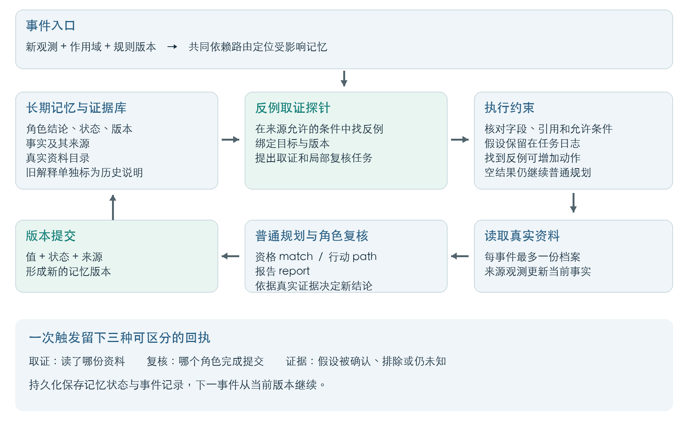
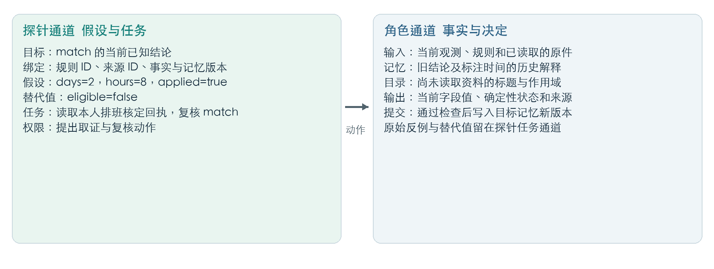

# 反例取证驱动的记忆探针

**面向多角色智能体的长期记忆主动复核方案**

智能体曾经给出正确建议，用户条件变化后，旧建议却可能继续被后续角色沿用。这个项目探索一种更主动的记忆维护方式：让模型寻找足以推翻旧结论的具体反例，把反例转成取证任务，再根据真实资料完成局部复核与版本更新。

当前原型在 `career-agent-lab` 中实现资格、行动、报告三个角色的连续协作。最新一轮72个连续事件中，反例探针组完整结论正确数由普通流程的52提升至64；正确且有实际证据支持的事件由49提升至64。相较普通额外复核，探针用量为487,240对520,048总token，对应正确数为64与66，提供了可观察的质量与成本选择。


## 从现象到问题

例如，旧记忆认为用户符合某岗位资格，申请仍在处理中。后来排班变为多种候选，系统需要重新判断资格、行动和报告结论。难点不仅是发现新旧文字不同，还包括：哪些旧结论可能失效、哪种条件能推翻它、应读取什么资料，以及取证结果应该交给哪个角色。

我们的核心问题是：**能否让模型把“这条记忆可能错了”转成一个可以执行、可以追踪结果的证据请求？**

## 原创机制

本方案自行设计“反例—取证任务—角色复核”的协议与执行链。探针输出有四个要素：

1. **明确目标**：绑定当前角色结论、规则、事实版本和目标记忆版本。
2. **可核验反例**：从来源允许的条件中构造一个会改变目标结论的实例。
3. **具体取证动作**：选择资料目录中的真实档案，形成局部复核请求。
4. **可区分的回执**：分别记录读到了什么、哪个角色完成提交、假设被确认或排除，或证据仍未知。



反例只增加取证或复核动作。没有找到反例时，普通规划流程继续运行。实际事实由来源观测更新；原始反例与替代值保留在任务通道，后续角色依据真实证据独立决定。当前程序核对字段、引用和允许条件；反例是否真正成立由实验评分器另行核验。



## 与现有产品的差异化

下表比较各产品公开文档描述的主要机制与本项目的设计重心。

| 产品或框架 | 公开的记忆能力 | 本项目着重解决的问题 |
|---|---|---|
| [Mem0](https://docs.mem0.ai/core-concepts/memory-operations/update) | 定位记忆ID，更新内容或元数据，并重新检索检查更新 | 在决定如何更新前，形成“什么条件会推翻旧结论、需要什么证据”的具体任务 |
| [Letta](https://docs.letta.com/agent-sdk/memory) | 持久状态、可编辑与共享的记忆文件，以及后台整理机制 | 将相关条件变化映射到具体角色的反例取证与局部复核 |
| [Claude Memory 与 Dreams](https://platform.claude.com/docs/en/managed-agents/dreams) | 跨会话记忆、版本审计，以及根据既有记忆和历史会话整理记忆 | 用来源约束下的反例主动请求核定资料，并把取证与复核提交分开记录 |

项目的原创设计集中在这套**面向已生成建议的可执行探针协议**及其同预算检验。它可作为已有记忆系统之上的复核层。理论上，具体反例有助于定位失效条件，角色级任务有助于减少无关重算，事实与假设分离有助于保持更新依据清晰。

研究上，[StateGraph](https://arxiv.org/abs/2611.02912) 讨论依赖感知的记忆修订与反事实验证，[COUNTERMEM](https://arxiv.org/abs/2609.31874) 讨论经验证的反事实记忆，[CRITIC](https://arxiv.org/abs/2305.11738) 讨论工具反馈纠错。本项目将相关能力组织成反例驱动的取证任务，并在连续、多角色状态上检验其效果。

## 三轮代表性实验

三轮分别解决协议、提交和主动取证三个层面的问题。各轮使用自己的数据与评分标准，表内比较均为同期对照。

### 第一轮 双模型同题比较与状态动作接口改进

发现的问题是：资格、行动和外部回执状态的定义混在一起，模型正文与结构字段可能表达不同处置。改进方式是明确状态及动作接口，并比较静态卡、自由探针和条件式探针。

每模型每组54个测试格，来自3个岗位、9个分支和2档上下文。GPT配置为 `gpt-6.1-sol / medium / 8192`，DeepSeek为 `deepseek-flash / thinking disabled / 1100`；两者使用相同题目、上下文预算及回读权限。严格通过同时检查标签、处置和正文证据。

| 组别 | DeepSeek 主评审 | GPT 主评审 | DeepSeek GPT复核 | GPT GPT复核 |
|---|---:|---:|---:|---:|
| 原协议＋自由探针 O | 2/54 | 13/54 | 2/54 | 13/54 |
| 明确接口＋静态卡 B | 29/54 | 42/54 | 18/54 | 33/54 |
| 明确接口＋自由探针 L | 29/54 | 43/54 | 12/54 | 39/54 |
| 明确接口＋条件探针 N | 31/54 | 43/54 | 16/54 | 40/54 |

“主评审”列按生成模型区分，评分模型均为DeepSeek；后两列使用GPT评分。保持自由探针不变时，接口改进使两模型主评审通过数分别从2提升至29、从13提升至43。由此确定后续工程基础：先把目标状态和动作说清楚，再让探针承担主动取证。后续重点转向真实回执读取、提交一致性以及连续事件中的局部复核。

数据与完整评分：[01-cross-model](experiments/01-cross-model/)。

### 第二轮 改善结论到记忆提交的一致性

发现的问题是：模型说明已经得出正确结论，但提交字段仍保留旧值。改进方式是只调整JSON示例键序，让简短结论说明先于提交字段生成，并保留额外一次复核作为对照。

| 方案 | 新72例正确数 | 已见24例回归 | 全96例独立策略总token |
|---|---:|---:|---:|
| 原提交顺序 | 66/72 | 20/24 | 290,435 |
| 说明先行 | 70/72 | 24/24 | 289,863 |
| 额外提交复核 | 71/72 | 23/24 | 573,481 |

说明先行修复了5个新例中的正文与字段冲突，新例正确率由91.7%提升至97.2%，token基本持平。此后将清晰、稳定的提交接口作为三组共同基础，使主动探针实验集中检验取证决策。

数据与逐例记录：[02-commit-consistency](experiments/02-commit-consistency/)。

### 第三轮 反例触发取证的连续事件闭环

将探针从附带检查提示改为可执行任务：提出反例、选择真实资料、强制安排局部复核，再记录结果。数据为3种新岗位、12条轨迹、每条6个事件；覆盖排班变化、规则调整、申请撤回、开放未知及其他作用域干扰。

三组每事件共同上限为5次调用、每次3072输出token、最多读取一份资料。各组保留自己的连续状态，第四事件重读磁盘状态。所有后续结果都承接此前的实际记忆版本。

| 方案 | 全部角色正确 | 正确且证据充分 | 角色复核调用 | 读档次数 | 独立策略总token |
|---|---:|---:|---:|---:|---:|
| 普通流程 | 52/72 | 49/72 | 106 | 6 | 390,248 |
| 普通额外复核 | 66/72 | 66/72 | 138 | 12 | 520,048 |
| 反例取证探针 | 64/72 | 64/72 | 117 | 11 | 487,240 |


相较普通流程，探针组完整正确率提高16.7个百分点，正确且有实际证据支持的比例提高20.8个百分点。相较普通额外复核，探针少用21次角色复核、总token减少6.3%，对应64/72与66/72的正确结果。

31次搜索生成46条成立的反例，全部形成局部复核任务。11次档案读取服务31条目标任务，其中15条假设被真实观测确认、16条被排除。两种结果都帮助系统重新确定旧建议的适用条件。56个可发现的目标机会中识别出46个，下一步优化重点是反例召回和更稳定的取证选择。

实验使用合成岗位与规范化观测，每组一次运行；同一轨迹内事件相互关联。模型负责反例计算、资料选择和角色判断，程序提供声明依赖、版本绑定与作用域检查。理论上的局部维护收益与表中已测量的正确率、读取和token分开呈现。

数据、原始调用及逐事件审计：[03-active-evidence](experiments/03-active-evidence/)。

## 阅读与复核

- `experiments/`：三轮输入、评分和正式结果。业务人物与岗位均为实验设定；公开导出去除本机路径、凭据和私有服务地址。
- `runtime/`：主动探针的可移植实现，包含普通流程、普通额外复核和反例探针。
- `scripts/`：不调用模型的离线复核工具。
- `assets/`：问题场景、架构、上下文分工和结果图。
- `docs/`：机制与产品比较的参考资料。

直接检查已保存结果无需模型密钥：

```bash
cd research/memory-evidence-probe
python3 scripts/verify.py
python3 scripts/privacy-check.py
node --test runtime/engine.test.mjs
```

如需重新进行第三轮模型实验，使用 Node.js 24 或更高版本安装依赖，并预先在环境中配置 `DEEPSEEK_API_KEY`。以下 `--register` 冻结本次代码和数据，`--live` 才会发送模型请求并产生服务费用：

```bash
npm install --ignore-scripts
node runtime/run.mjs --register live-runs/example-01
node runtime/run.mjs --live live-runs/example-01
```

新结果写入独立目录，已公开的历史记录保持可复核。运行时的移植说明见 [portability.json](runtime/portability.json)。

对概念、JSON结构、命名和答辩问题的解释，见 [读者常见问题与答辩要点](docs/读者常见问题与答辩要点.md)。

## 原型价值

项目已经把长期记忆维护落实为一个可执行闭环：从条件变化出发，提出足够具体的反例，获取真实证据，再由相应角色完成局部更新。双模型实验帮助确定清晰的状态动作协议，提交实验改善字段一致性，连续事件实验展示主动取证带来的初步收益。后续将围绕反例召回、自然语言条件抽取和更长的事件序列继续扩展。
